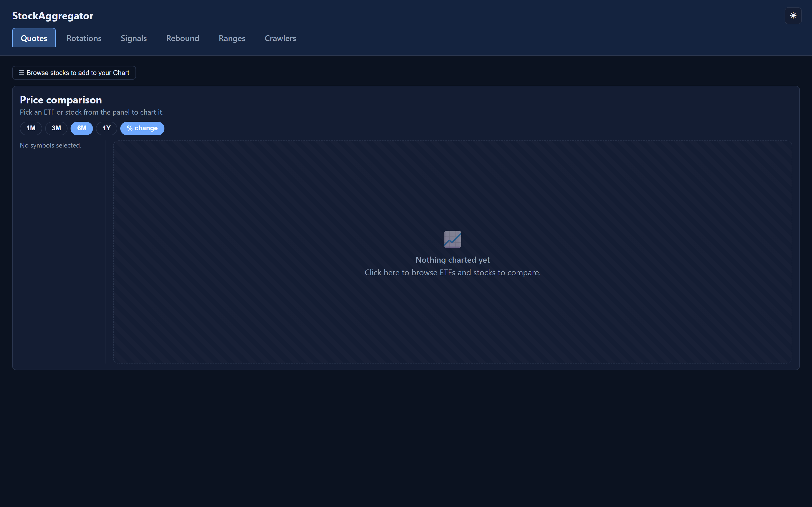
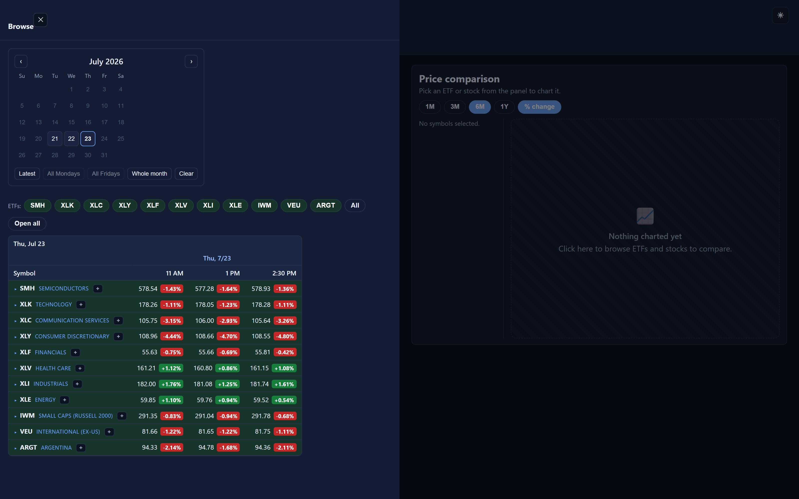
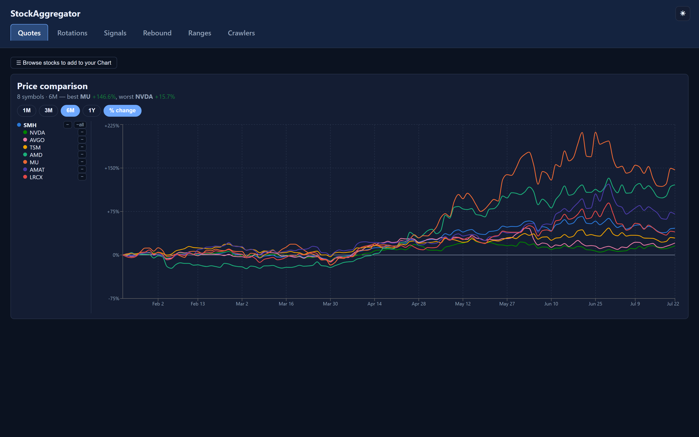
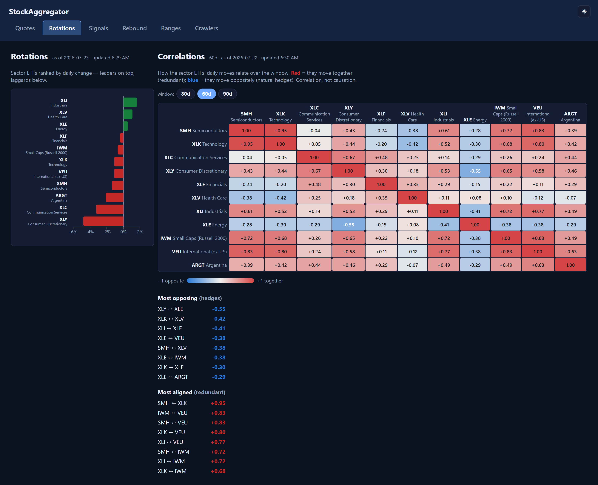
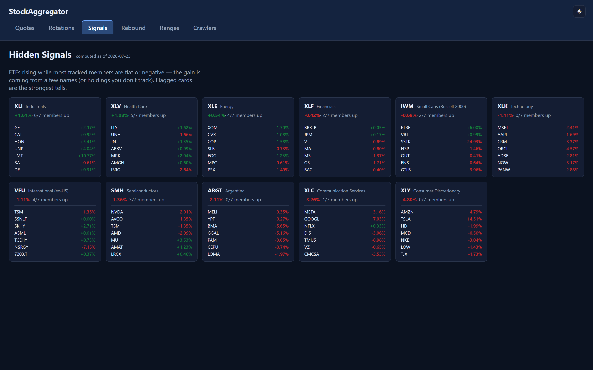
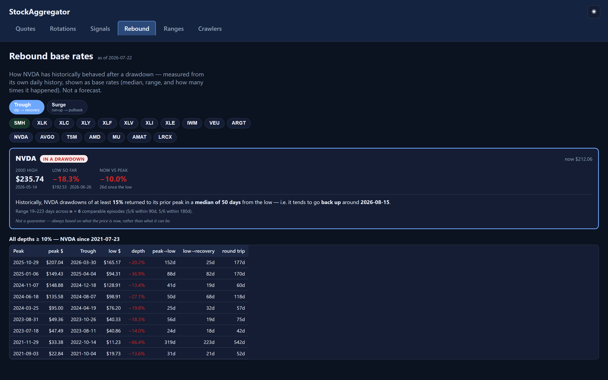
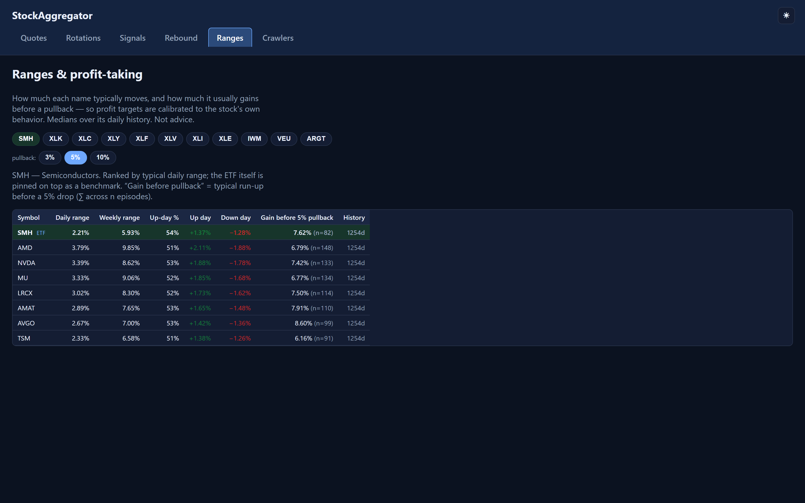
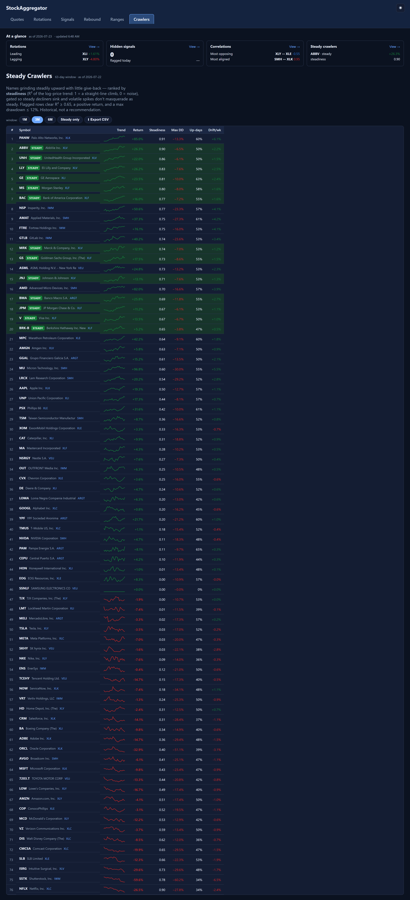

# StockAggregator

A self-hosted market dashboard. An Azure Functions pipeline snapshots quotes from
[Yahoo Finance](https://finance.yahoo.com) on a schedule and stores them in Azure SQL;
a .NET web API + React single-page app turn that history into a set of focused analytics
views — sector rotation, hidden divergences, historical rebound odds, volatility ranges,
and steady climbers.

**Live:** <https://stockaggregator-web.azurewebsites.net/>

> Educational/portfolio project. Nothing here is financial advice.

---

## What it does

Symbols are grouped into eleven sector "ETF + members" baskets (Semiconductors, Technology,
Financials, Energy, …). Four times each trading day a timer function captures a price snapshot
of every tracked symbol; a nightly job rolls those snapshots up into per-day analytics, and a
one-off backfill pulls ~2 years of daily OHLC so the historical screens have something to chew on.

The dashboard reads that data through a read-only API. Every page is a different lens on the
same underlying quotes.

---

## The dashboard

At the top of every page, an **At a glance** hero summarizes the day — the leading/lagging
sector, how many hidden signals flagged, the most-opposing and most-aligned ETF pair, and the
steadiest climber — each linking through to its full page. Light and dark themes are supported
(toggle top-right).

### Quotes — price comparison + snapshot grid

The landing page. A live comparison chart sits front and center; open **Browse** to pick days
from the calendar and add ETFs (and their member stocks) to the chart. The chart normalizes to
% change by default and supports 1M/3M/6M/1Y windows.

| Empty state | Browse panel | Populated |
| --- | --- | --- |
|  |  |  |

- **Empty state** — the chart is always visible; before you pick anything it shows a placeholder inviting you to browse.
- **Browse panel** — a slide-out with the calendar (pick one or many days), ETF filters, and the snapshot grid. Each row's capture times (8:30 / 11:00 / 1:00 / 2:30 CT) are colored by direction. The `+` on an ETF row adds it and its members to the chart.
- **Populated** — normalized price lines with a per-symbol legend; remove an ETF (keeping its stocks), or an ETF with its stocks, or individual tickers.

### Rotations & Correlations



Sector ETFs ranked by daily change (leaders on top, laggards below), paired with a correlation
heatmap of the sectors' daily returns over a 30/60/90-day window. **Red = move together**
(redundant), **blue = move oppositely** (natural hedges), with the most-opposing and most-aligned
pairs called out below.

### Signals — hidden divergences



Flags ETFs that are rising while most of their tracked members are flat or falling — i.e. the
gain is coming from a few names (or from holdings you don't track). Each card shows the ETF's
move, how many members are up, and the per-member breakdown.

### Rebound — historical base rates



Pick a symbol and a mode — **Trough** (dip → recovery) or **Surge** (run-up → pullback). From the
symbol's own daily history it computes base rates: after a drawdown of at least *N%*, how long it
has historically taken to reclaim the prior peak (median, range, and episode count), plus a table
of every comparable episode. Framed as "what has happened," explicitly not a forecast.

### Ranges — profit-taking calibration



For a chosen ETF and its members: typical daily and weekly range, up-day share, average up/down
day, and the typical **gain before a pullback** of a chosen size (3/5/10%). The ETF is pinned on
top as a benchmark, so profit targets can be calibrated to each name's own behavior.

### Crawlers — steady climbers



Every tracked member ranked by **steadiness** — the R² of its log-price trend (1 = straight-line
climb, 0 = noise) — gated so steady *decliners* sink and volatile spikes don't masquerade as steady.
Rows clearing R² ≥ 0.65 with a positive return and max drawdown ≤ 12% are flagged **STEADY**.
Includes sparklines, a "steady only" filter, and CSV export.

---

## Architecture

```
StockAggregator/            Azure Functions (.NET 10 isolated) — the data pipeline
  Functions/                Timer + HTTP triggers (snapshots, rollup, backfill, keep-warm, health)
  Services/                 Yahoo fetch, snapshot orchestration, analytics rollup, SQL access
StockAggregatorApp/         ASP.NET Core web API — read-only endpoints, serves the built UI
  Controllers/              /api/quotes/*, /api/analytics/*
  Repositories/ Services/   Parameterized SQL reads + analytics query services
StockAggregator.UI/         React + Vite + TypeScript SPA (Recharts, react-query, react-table)
  src/pages/                One component per dashboard page
  e2e/                      Playwright suite (also generates the README screenshots)
infra/                      Bicep for the Function App, Web App, and Azure SQL
sql/                        Schema DDL + Entra grants (run once)
```

Both the pipeline and the web API talk to Azure SQL using **Microsoft Entra access tokens**
(managed identity in Azure, `az login` locally) — no SQL passwords. See
[README-Azure.md](README-Azure.md) for the auth and deployment details.

---

## Data pipeline

Four timer-triggered functions fire on trading days (Mon–Fri), each capturing a snapshot of every
configured symbol into `dbo.StockQuotes`:

| Function          | Central time | CRON (`sec min hour day month dow`) |
| ----------------- | ------------ | ----------------------------------- |
| `Snapshot_0830CT` | 08:30        | `0 30 8 * * 1-5`                    |
| `Snapshot_1100CT` | 11:00        | `0 0 11 * * 1-5`                    |
| `Snapshot_1300CT` | 13:00        | `0 0 13 * * 1-5`                    |
| `Snapshot_1430CT` | 14:30        | `0 30 14 * * 1-5`                   |

Supporting functions:

- **`AnalyticsRollup_Nightly`** — recomputes the daily analytics rollup after the close (weeknights).
- **`KeepWarm`** — pings the web app every 10 minutes, 24/7, so visitors don't hit a cold start.
- **HTTP triggers** (`manual-snapshot`, `analytics/rollup`, `backfill`) — on-demand runs. These require a Function key (`?code=…`); `health` is anonymous.

Quotes come from Yahoo Finance's public **chart** endpoint (`/v8/finance/chart/{symbol}`) — no API
key or quota, one request per symbol. A symbol that fails is logged and skipped so one bad ticker
doesn't sink the run. Non-US symbols need a Yahoo suffix (e.g. `7203.T`, `ASML.AS`).

---

## Configuration (app settings)

| Setting               | Purpose                                                        |
| --------------------- | ------------------------------------------------------------- |
| `StockSymbols`        | Comma-separated tickers, e.g. `NVDA,AAPL,MSFT` (non-US need a Yahoo suffix, e.g. `7203.T`) |
| `SqlConnectionString` | Azure SQL connection string. Uses Microsoft Entra — no password (see [README-Azure.md](README-Azure.md)) |
| `YahooChartBaseUrl`   | Optional. Defaults to `https://query1.finance.yahoo.com/v8/finance/chart` |
| `WEBSITE_TIME_ZONE`   | Set to `Central Standard Time` so timers run on CT + follow DST |
| `ApiKey`              | Web API only. Empty locally (open); set in Azure to require the `X-Api-Key` header |
| `Cors:AllowedOrigins` | Web API only. Origins allowed to call the API in dev (prod is same-origin) |

**Locally** the Functions settings live in `.env` (git-ignored). Copy the template and fill it in:

```
cp .env.example .env
```

`Program.cs` loads `.env` into the environment at startup. In Azure the file is absent and values
come from Function App / Web App application settings instead. The web API reads its own settings
from `StockAggregatorApp/appsettings.json` (plus environment overrides).

---

## Run locally

The dashboard is the API and the UI running together against Azure SQL (auth via your `az login`).

1. **Database** — run the scripts in [`sql/`](sql/) once to create the schema, then trigger the
   `backfill` function (or run a few snapshots) so there's data to show.
2. **API** (`:5080`):
   ```
   dotnet run --project StockAggregatorApp
   ```
3. **UI** (`:5173`) — in another terminal:
   ```
   cd StockAggregator.UI
   npm install
   npm run dev
   ```
   The dev UI calls the API at `http://localhost:5080`; a production build is served by the API itself.

To run the data pipeline instead of the web app, install the Azure Functions Core Tools
(`npm i -g azure-functions-core-tools@4`) and `func start` from the repo root.

---

## Tests

- **Backend unit + smoke tests** — `dotnet test StockAggregator.Tests`.
- **Dashboard e2e / screenshots** — `StockAggregator.UI/e2e/` is a Playwright suite that drives
  each page and asserts it renders. It doubles as the screenshot generator for this README:
  ```
  cd StockAggregator.UI
  npx playwright test          # smoke-test the dashboard (screenshots off)
  ```
  The suite's `webServer` config starts both the API and UI automatically. To regenerate the images
  in `docs/screenshots/`, flip `CAPTURE = true` at the top of `e2e/screenshots.spec.ts` and re-run
  from a clean build.

---

## Deploy

Pushes to `main` deploy via GitHub Actions — the Functions app and the web app (with the UI built
into its `wwwroot`) each have a workflow. Application settings come from the pipeline / Function App
configuration. Infrastructure is defined in [`infra/`](infra/) (Bicep). Full walkthrough:
[README-Azure.md](README-Azure.md).
